# TinyEdit 极简编辑器

**简体中文** | [English](README.en.md)

TinyEdit 是一款面向 **macOS** 的原生文本编辑器，专注于 TXT、Markdown（MD）、JSON 等常见文本文件的日常阅读与编辑。采用 SwiftUI 构建简洁、现代的界面，在保持轻巧的同时，提供日常所需的完整编辑功能。

TinyEdit 不包含文件夹管理、项目管理等 IDE 功能。打开文件即可阅读和修改，也可以直接输入内容，无需先新建文件。标签页和未保存的内容会自动保留，关闭窗口或退出应用后，再次打开即可继续编辑。

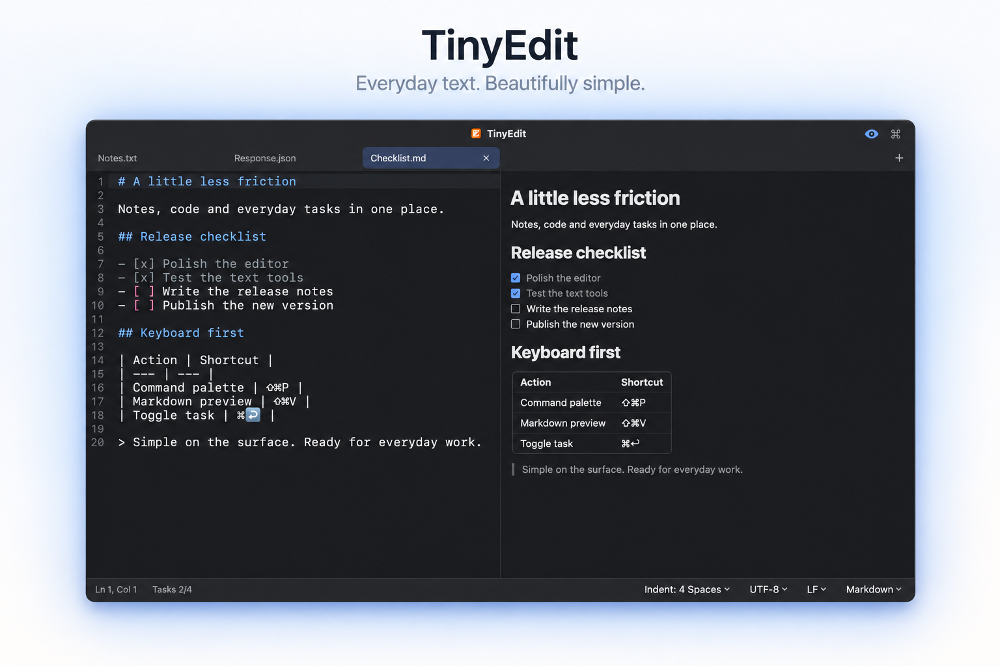

## 功能一览

以下截图统一使用英文界面和深色主题。TinyEdit 支持中文界面，可在设置中切换。

### 通用功能

| 功能名称 | 介绍 | 图片 |
| --- | --- | --- |
| 日常编辑 | 多标签页、查找替换、自动换行、行号、缩进参考线、括号配对和选中词高亮。支持按行复制、移动、删除、合并及切换注释。 |  |
| 文件与编码 | 支持 UTF-8、UTF-16、GB18030（兼容 GBK / GB2312），保留换行格式。文件被其他应用修改或删除时会提示，重新加载后标出变化的行。 |  |
| 自动恢复 | 自动保留标签页、未保存文本、光标和滚动位置。恢复内容与原文件分开存储，只有主动保存时才修改原文件。 |  |
| 图片文字识别 | 粘贴截图或拖入图片，即可将识别出的文字插入编辑区。使用 Apple Vision 在本机处理；macOS 26 上还可将表格识别为便于粘贴到表格软件的文本。 |  |
| 外观与语言 | 支持浅色、深色和跟随系统，提供记事本、代码编辑器、文稿、极简光标四款应用图标及多种编辑区背景。界面支持简体中文、繁体中文、英语、日语、韩语、德语、法语和西班牙语。 |  |
| 语法高亮 | 支持 JSON、Markdown、Python、JavaScript、TypeScript、Swift、SQL、YAML 等 36 种语言和格式，可根据文件和内容自动识别，也可通过底部栏手动切换。 | 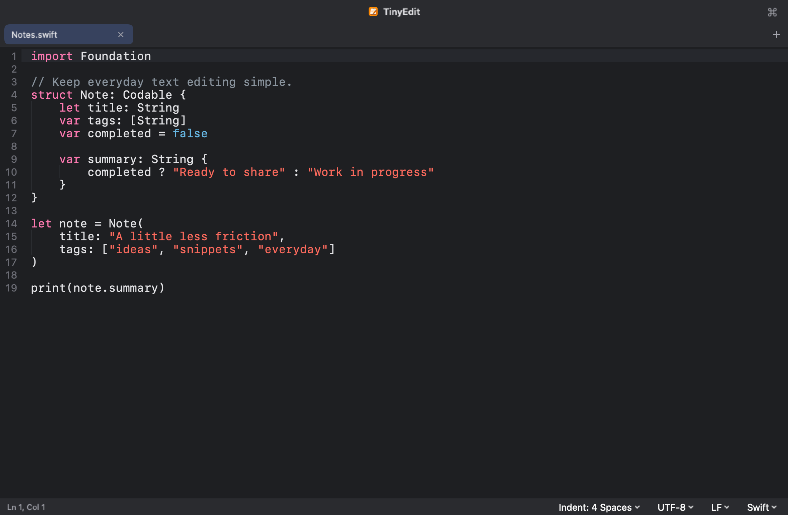 |
| 命令面板 | 按 ⇧⌘P 搜索并执行命令，也可以查找已打开的标签页。支持以下操作： • JSON：格式化、压缩、字符串转义与还原。 • 编码转换：Base64/URL 编解码、Unicode 转义还原、JWT 解码、Unix 时间戳转日期。 • 行处理：升序/降序排序、反转行顺序、随机打乱、移除重复行。 • 文本清理：移除空行、行尾空白、ANSI 转义码（终端颜色等）和不可见字符。 • 翻译与请求：翻译选中文字或整篇文档、发送 curl 请求。 文本工具优先处理选区，未选中时处理整篇文档；文本修改可以撤销。 | 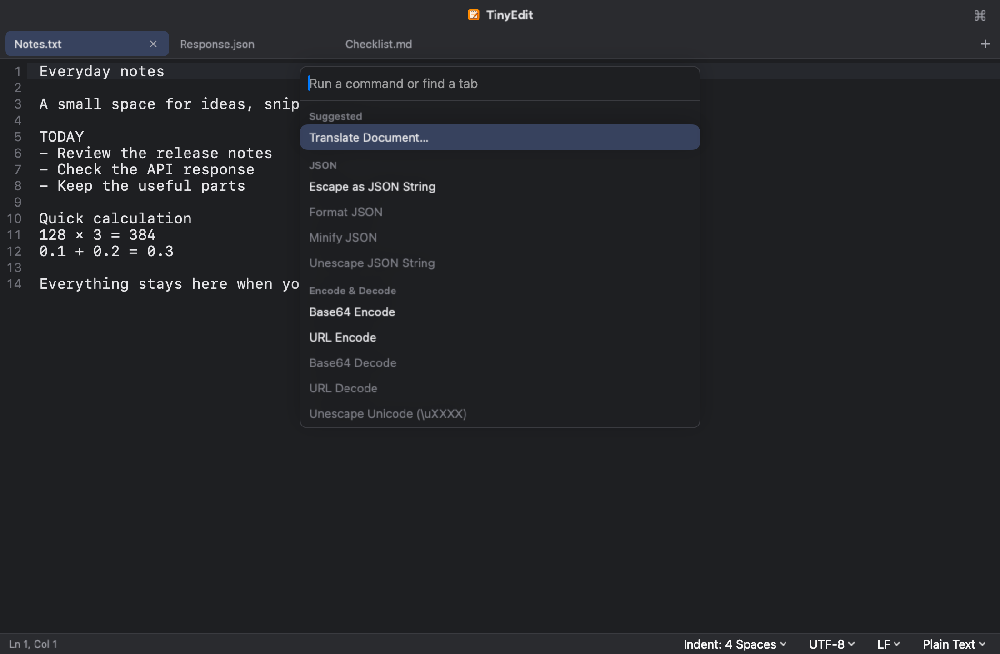 |
| 随手计算 | 在文本中输入算式，行尾便会提示结果，按 Tab 即可插入。支持四则运算、括号和全角符号，使用十进制计算，`0.1 + 0.2` 可得到 `0.3`。默认在纯文本中启用，也可扩展到 Markdown。 | 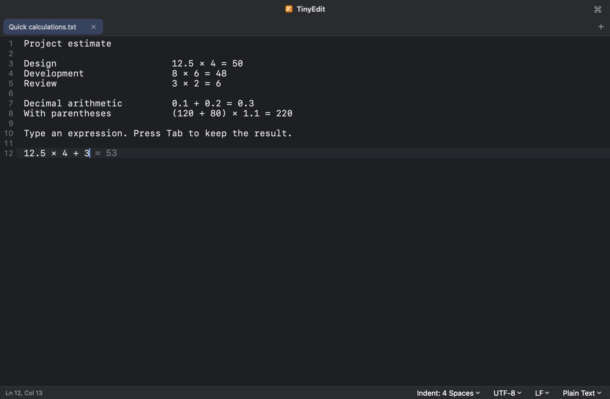 |
| curl 请求 | 粘贴 curl 命令后，可先查看请求信息，再点击 Send 直接发送。响应卡片显示状态码、耗时、大小、正文和响应头，JSON 正文会自动格式化；结果可以复制、替换原命令或在新标签页打开。无需启动终端，发送前不会发起请求。 | 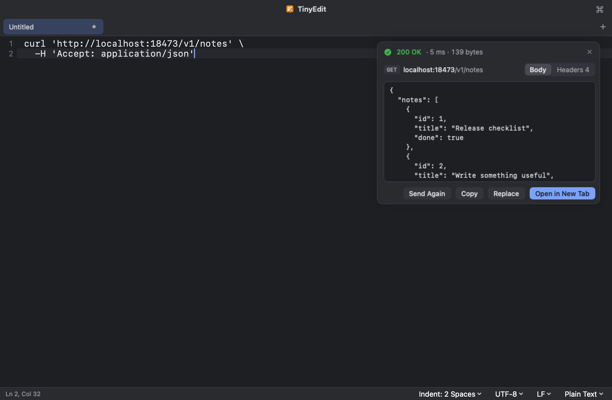 |
| 翻译 | 翻译选中文字或整篇文档，原文与译文并排显示。译文可以复制、替换原文或在新标签页打开。支持 Apple 系统翻译，以及兼容 OpenAI 接口的云端服务和本地模型；长文本分段处理，中断后可继续。 | 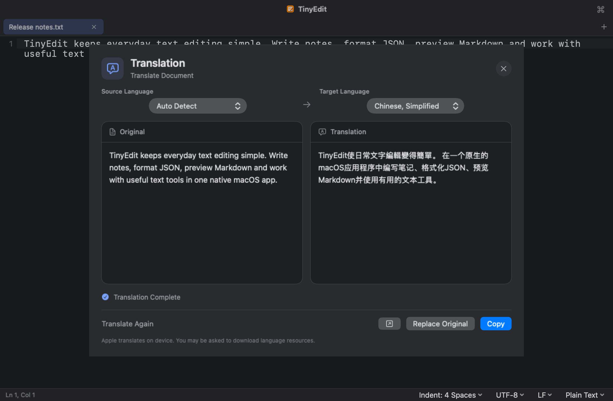 |
| 自动识别粘贴内容 | 以 Base64 为例，粘贴后即可查看解码结果，并选择复制或替换。还支持 JWT、URL 编码、Unicode 转义、JSON 字符串和 Unix 时间戳。粘贴内容含终端颜色代码或不可见字符时，也会提示清理。 | 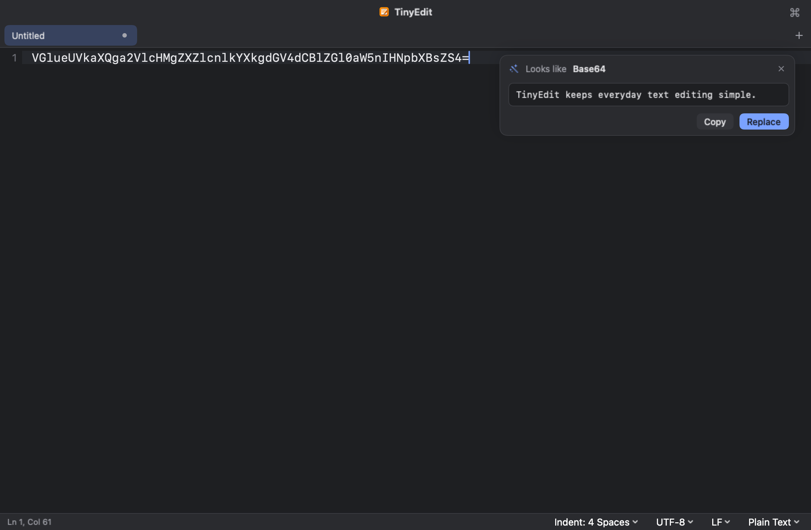 |

### Markdown

| 功能名称 | 介绍 | 图片 |
| --- | --- | --- |
| Markdown 预览 | 按 ⇧⌘V 并排查看正文与预览，支持标题、列表、引用、表格、代码块，以及普通图片和表格内图片；兼容 `` 尺寸设置与 ` ` 换行。 | 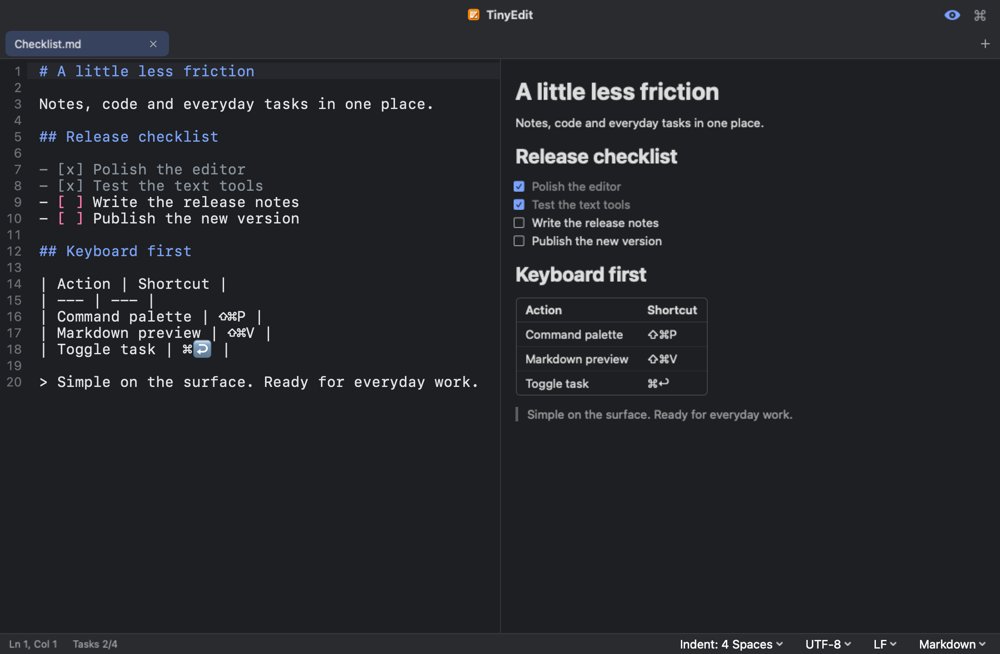 |
| 待办事项 | 使用 `- [ ]` 记录待办，点击预览中的方框或按 ⌘↩ 切换完成状态。底部栏显示完成进度，编辑时按回车可继续添加下一项。 |  |

### JSON

| 功能名称 | 介绍 | 图片 |
| --- | --- | --- |
| JSON 粘贴与格式化 | 将 JSON 粘贴到空白标签页，或替换整篇内容后，TinyEdit 会提示切换语法和格式化。点击即可整理缩进，无需另开工具。格式化保留键的顺序和数字原样，也支持压缩、字符串转义与还原。 | 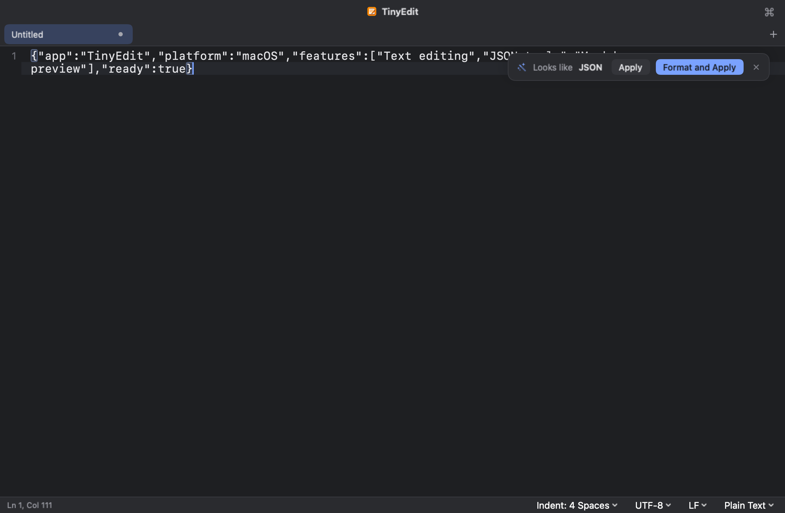 |
| 快捷取值与预览 | 将光标放在键或值上，可从底部栏复制路径、键和值。复制字符串时会去掉引号并还原转义。含图片链接或内嵌图片的行末会显示图片图标，点击即可预览，并查看尺寸和大小，复制或保存图片。对象字段数和数组项数会随光标位置显示在底部栏。行末保留时间戳日期、颜色及打开链接、解码内容等快捷提示。 | 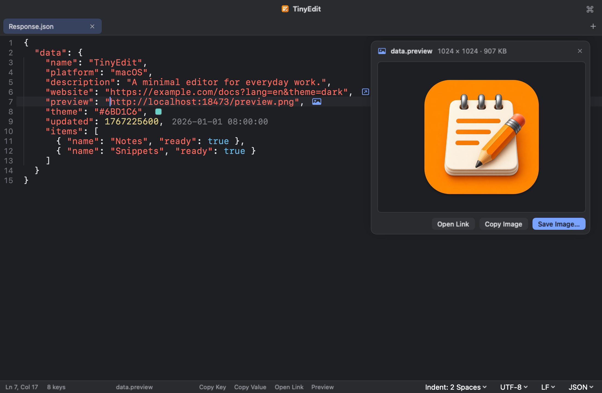 |
| Open Value：单独打开值 | 将光标放在对象、数组或普通字符串上，点击底部栏的 **Open Value**，即可在新标签页中查看和编辑该值，便于阅读较长的内容或嵌套数据。字符串会还原转义；字符串中包含的 JSON 对象或数组会自动格式化。 | 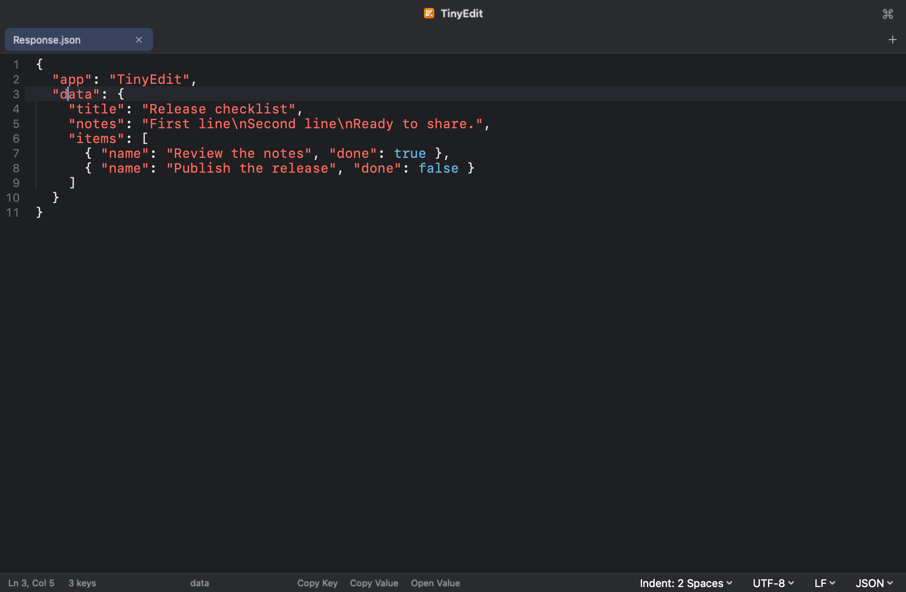 |

## 下载与安装

在 [Releases](../../releases) 页面下载最新版本，将 TinyEdit 拖入“应用程序”文件夹。

- macOS 15 或更高版本。
- Apple 芯片（M 系列）Mac，暂不支持 Intel Mac。
- 单个文件最大 64 MB；超过 2 MB 时仅高亮可见区域，超过 5 MB 时关闭语法高亮与 Markdown 预览。

## 隐私与联网

TinyEdit 不收集用户数据。文本编辑、图片文字识别、文本工具和内容恢复均在本机完成。Apple 系统翻译在本机运行，首次使用某种语言时可能需要下载语言包。

## 从源码构建

安装 Xcode 27 或更高版本及 XcodeGen，在仓库根目录运行 `xcodegen generate`，然后打开 `TinyEdit.xcodeproj`，选择 **TinyEdit** scheme 运行。

## 许可证

GNU 通用公共许可证第 3 版（GPL v3）。
